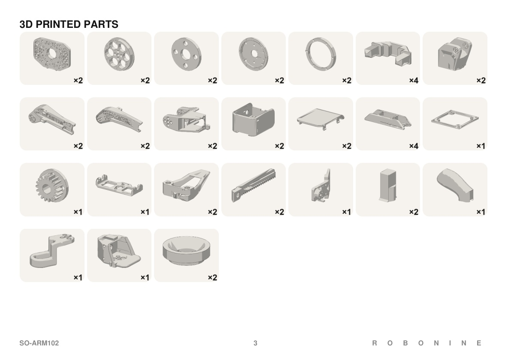

<!-- translation-navigation -->
[English](../../en/docs/printing.md) · [Русский](../../ru/docs/printing.md) · [Español](../../es/docs/printing.md) · [Français](printing.md) · [Deutsch](../../de/docs/printing.md) · [Português (Brasil)](../../pt-BR/docs/printing.md) · [简体中文](../../zh-CN/docs/printing.md) · [日本語](../../ja/docs/printing.md) · [हिन्दी](../../hi/docs/printing.md) · [العربية](../../ar/docs/printing.md)

[Original anglais](../../../printing.md)

[Documentation](../README.md) · [Impression](printing.md) · [Composants](bom.md) · [Montage](assembly-guide.md) · [Caractéristiques](specifications.md) · [Modèles](../models/README.md) · [Contribuer](../CONTRIBUTING.md) · [Licences](../LICENSING.md) · [Traductions](translations.md)

> Traduction intégrale du document. Les illustrations et le livret PDF original sont communs aux langues. Traduction assistée par IA, pas encore relue par des locuteurs natifs.
<!-- /translation-navigation -->

<!-- translated-content -->

# Impression des pièces

Chaque partie imprimée du kit SO-ARM 102 est dans [`../models/stl/`](../../../../models/stl).Les CAD sources modifiables avec les mêmes noms sont dans [`../models/step/`](../../../../models/step).

- `common/` contient les pièces utilisées par les deux bras robotiques. Imprimez une seule fois la quantité indiquée. Elle couvre déjà deux bras robotiques.
- `follower/` contient la pince parallèle, le support de caméra et le boîtier du bras robotique.
- `leader/` tient la poignée, la gâchette, le rouleau de poignet et le boîtier du bras robot leader.

Toutes les pièces s'adaptent à une plaque de construction d'imprimante 3D 180 × 180 mm La plus grande partie, la base, mesure 160 × 112.5 mm.

## Matériau

| Emplacement | Matériau | Raison |
|---|---|---|
| Mailles de bras, base, supports de servomoteur | PET-CF, recuit si possible | Option la plus rigide et résistante à la chaleur testée près de servomoteurs chauds |
| Pinces de préhension, couvercles, poignée et déclencheur du bras robot leader | PETG ou PET-CF | Plus résistant contre les chocs |

Le prototype a été imprimé en **Fiberon PET-CF17**. Dans nos tests de filament, le recuit réduit la déviation du PET-CF17 après une heure à 65–70 °C de 3.4 mm à 0.3 mm. Le recuit rend également la pièce plus fragile, alors ne recuitez pas les pièces qui subissent des impacts. Détails: [Choisir un filament pour les bras robotiques](https://robonine.com/choosing-filament-for-robotic-arm-applications/).

Le bras robotique du leader ne porte aucune charge, donc PLA devrait suffire pour lui.Cela n'a pas encore été testé.

## 3MF projets de slicer

Les [3MF projets](../models/README.md#3mf-slicer-projects) incluent des orientations de pièces, des dispositions de plaques et des paramètres de support sauvegardés.Ouvrez-les en tant que projets dans **Bambu Studio**, sélectionnez votre imprimante et votre filament, puis coupez et consultez l'aperçu du support.

| Projet | Profil de filament enregistré | Hauteur de couche | Parois | Couches supérieures / inférieures | Remplissage | Masse | Durée |
|---|---|---|:-:|:-:|---|:-:|:-:|
| [Bras leader](../../../../models/3mf/SO102_leader.3mf) | Bambu PETG-CF | 0.20 mm | 3 | 5 / 4 | 15 % gyroïde | 457 gr | 23 h |
| [Bras robotique de suivi](../../../../models/3mf/SO102_follower.3mf) | Fiberon PET-CF17 | 0.20 mm | 6 | 6 / 6 | 30 % cubiques | 583 gr | 23 h |
| [Préhenseur de bras robotique Follower et boîtier de carte](../../../../models/3mf/SO102_follower_gripper_box.3mf) | Bambu PETG-CF | 0.20 mm | 6 | 6 / 6 | 30 % cubiques | 131 gr | 6,5 h |

Avec ces paramètres, vous aurez besoin de: Fiberon PET-CF17 583 gr, Bambu PETG-CF 588 gr.

Tous les trois enregistrent un profil de buse **Bambu Lab A1, 0.4 mm**sur une plaque de construction d'imprimante 3D**256 × 256 mm**. Les pièces individuelles s'adaptent toujours à une plaque de construction d'imprimante 3D 180 × 180 mm, mais les dispositions fournies doivent être réparties sur plusieurs plaques pour cette taille.Les supports automatiques d'arbre sont la valeur par défaut globale; certaines pièces ont des remplacements de support, des paramètres de support manuels ou des bloqueurs de support.

Imprimez chaque projet une fois pour obtenir un kit complet, puis imprimez **une attache de câble supplémentaire** : les projets en contiennent deux au total, alors que la liste des pièces en exige trois.

| Disposition du bras robot Leader | Préhenseur de bras robotique Follower et disposition du boîtier |
|:-:|:-:|
|  |  |

## Test-robot arm slicer settings

Les 3MF projets fournis ci-dessus utilisent des profils différents; coupez-les à nouveau en utilisant le slicer d'impression 3D pour obtenir les estimations du filament et du temps d'impression.

| Paramètre | Valeur |
|---|---|
| Parois | 4 |
| Couches supérieures et inférieures | 4 |
| Remplissage | 25 % gyroïde |
| Supports | Oui, si nécessaire |

Pour l'engrenage de la pince et les crémaillères, utilisez 100 % de remplissage.

**Plus de remplissage rend le bras robotique suivant plus rigide.** Avec 100 % de remplissage sur tous les maillons et 35 % sur la base, la déviation du préhenseur sous 300 g a diminué de 3.4 mm à 2.34 mm. Le coût est le filament et le temps: environ 720 g et 27 h au lieu de 500 g et 21 h, préhenseur non inclus. Pour le bras robotique leader, gardez le remplissage bas. Il doit seulement être léger et rapide à imprimer.

**L'orientation est importante.** Les bras robotiques supérieurs impriment mieux inclinés, de sorte que la surface ressort propre et que la section mince ne se fissure pas. Posez les pièces longues de manière à ce que les lignes de couche courent le long de la longueur de la pièce.

## Liste des pièces

Les quantités sont pour un kit complet: un bras robotique de suivi et un bras robotique leader.

### Pièces communes, les deux bras robotiques

| Référence | Nom | Qté |
|---|---|:-:|
| SO102.02.010 | Base | 2 |
| SO102.02.020 | Anneau de base | 2 |
| SO102.02.030 | Rondelle de base | 2 |
| SO102.02.040 | Plaque supérieure de la base | 2 |
| SO102.02.050 | Anneau inférieur | 2 |
| SO102.02.060 | Support inférieur de servo | 2 |
| SO102.02.070 | Segment inférieur | 4 |
| SO102.02.080 | Segment supérieur gauche | 2 |
| SO102.02.080-01 | Segment supérieur droit | 2 |
| SO102.02.090 | Support de poignet | 2 |
| SO102.02.130 | Clip de câble | 3 |

### Bras robotique de suivi seulement

| Référence | Nom | Qté |
|---|---|:-:|
| RB9.01.062.011 | Châssis principal (D6.1) | 1 |
| RB9.01.062.024 | Mâchoire (D6.1) | 2 |
| RB9.01.062.030 | Crémaillère | 2 |
| RB9.01.062.040 | Pignon de la pince | 1 |
| RB9.01.062.100 | Goupille | 2 |
| RB9.01.062.075 | Support de caméra | 1 |
| RB9.01.062.090 | Entretoise de caméra | 1 |
| SO102.02.100 | Support de carte du suiveur | 1 |
| SO102.02.100-01 | Couvercle de carte du suiveur | 1 |

`(D6.1)` signifie que les alésages des tiges sont dimensionnés pour 6.1 mm.Voir les problèmes connus dans le README principal si la pince fonctionne serrée.

### Bras robotique Leader uniquement

| Référence | Nom | Qté |
|---|---|:-:|
| — | Gestionnaire SO102 | 1 |
| — | Déclencheur SO102 | 1 |
| — | SO102 Rouleau de poignet | 1 |
| SO102.02.110 | Support de carte du leader | 1 |
| SO102.02.110-01 | Couvercle de carte du leader | 1 |

## À propos des fichiers STL

Les STL fichiers ont été exportés à partir des STEP sources avec une tolérance d'accord de 0.02 mm.Si vous changez une partie, modifiez le STEP et exportez un nouveau STL avec le même nom.
<!-- /translated-content -->
